# Gravity Engine

A 2D physics sandbox built with Rust, [macroquad](https://github.com/not-fl3/macroquad) and [rapier2d](https://rapier.rs/). Drop images, spawn shapes or fetch retro web buttons — everything becomes a rigid body you can throw, pull, spin and blow up.


**[Play it in your browser](https://elimanee.github.io/gravity-engine/)**, or [download it](#download) for Linux and Windows.

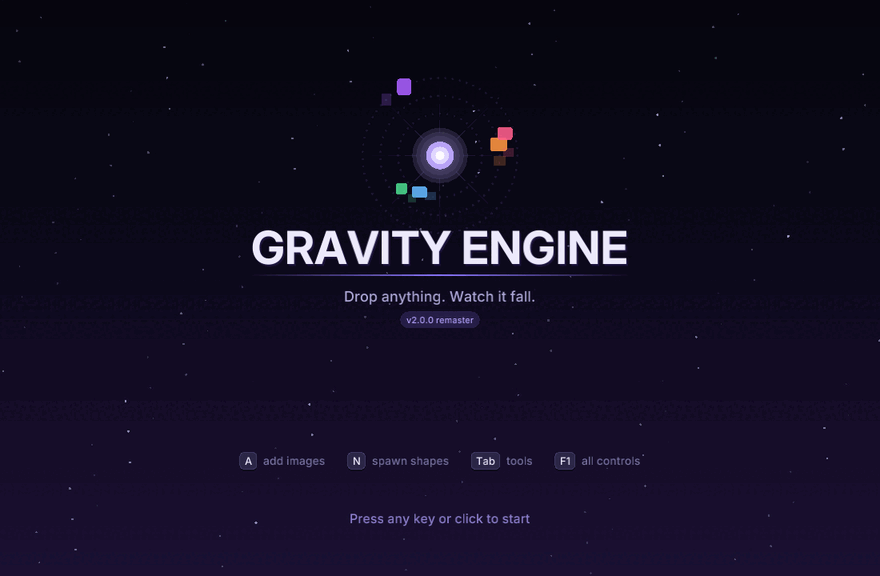

| Sandbox | Settings drawer (Space) | Tool picker (Tab) |
|---|---|---|
| 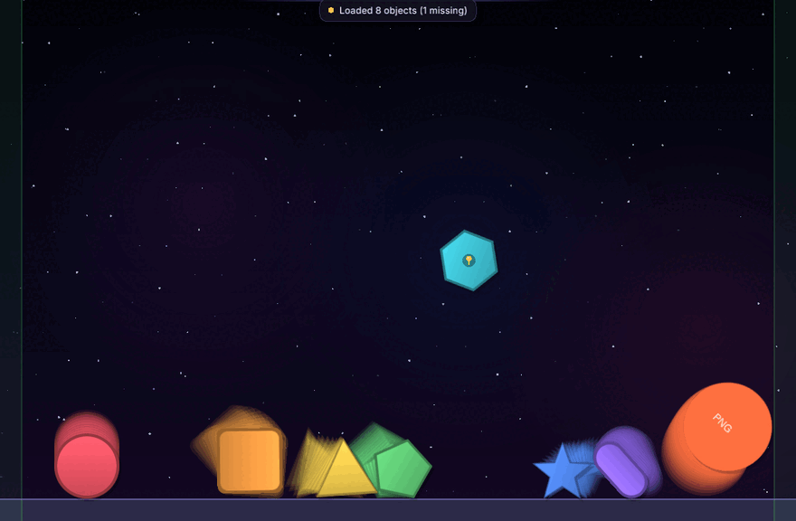 | 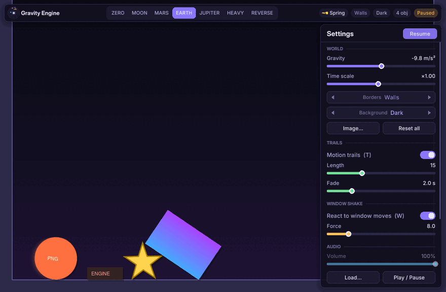 | 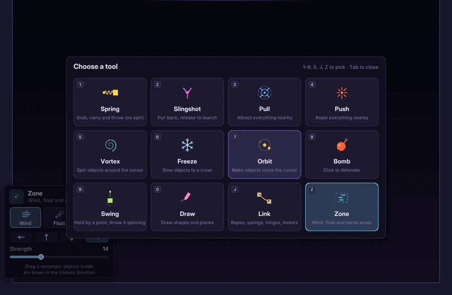 |

## What's new in 3.1

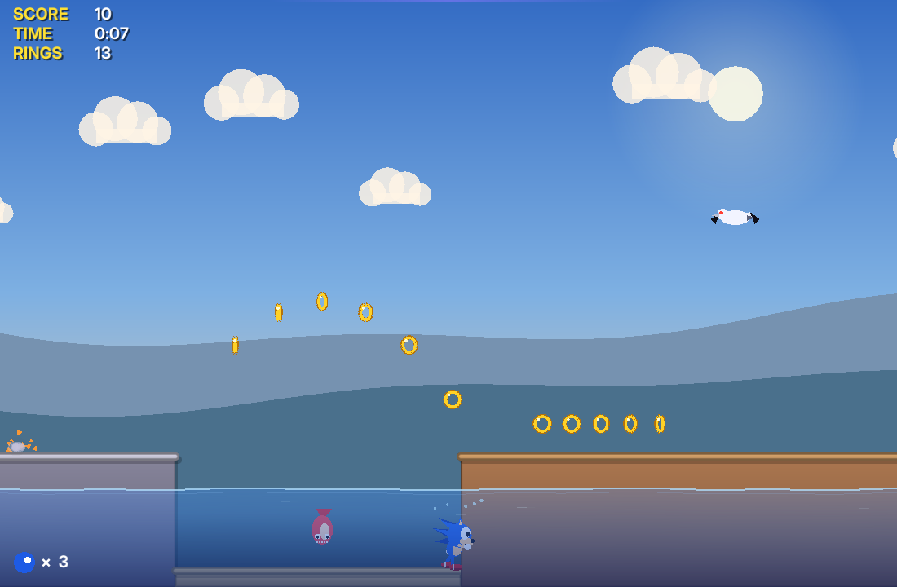

### Play in the browser

Gravity Engine now runs in a web page: **[elimanee.github.io/gravity-engine](https://elimanee.github.io/gravity-engine/)** (built and published by the *Web version* workflow whenever `master` changes). It is the same program compiled to WebAssembly: the sandbox, the tools, the challenges, Sonic's acts, the endless run and the level editor all work, and your settings, levels, challenges and best runs are kept in the browser's storage. What needs files or the network on your computer — opening images, music, scenes or skins, the button and logo fetchers, screenshots and GIF recording, your own sprite sheets — says *That needs the desktop version*.

### Harbour zone

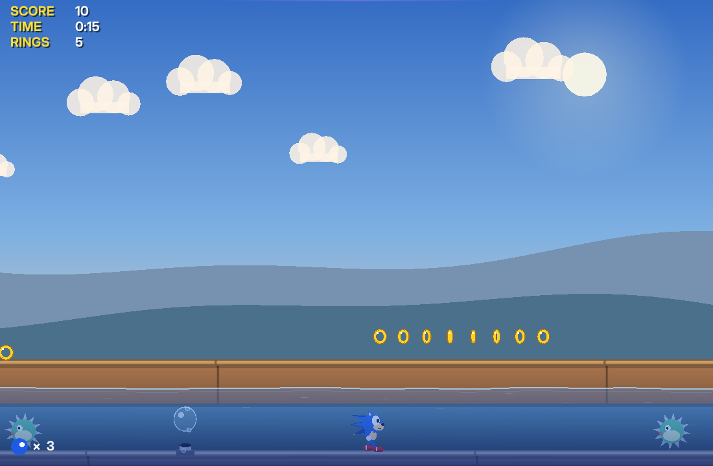

Three new acts after Meadow, over the sea, in Library → Sonic:

- **Harbour Act 1** — along the docks: fall into the sea between the piers and jump out again; **fish** leap out of the water and **gulls** hover, cry out and swoop down at you.
- **Harbour Act 2** — a flooded tunnel under the docks. Under water, **air runs out**: chimes after 5, 10 and 15 seconds, then a countdown over your head (5… 0) with its music, and you drown at the end. **Vents** on the floor let out big bubbles: touch one to breathe. **Puffers** float about and bristle with spikes now and then — they hurt even when you are curled up, so wait for the spikes to go in. (Tails and Knuckles can take the deck above instead.)
- **Harbour Act 3** — the **anchor crane**: a flying crane with an anchor swinging under it, which now and then slams the anchor down and sends shock waves along the pier to jump over. Hit the cab, not the anchor.

After losing a life you are safe for a moment, so nothing waiting at the star post takes the next one straight away.

### Special stages and the chaos emeralds

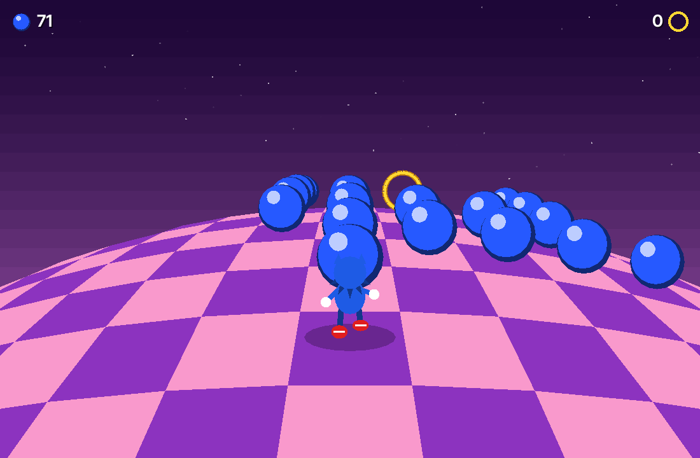

Reach the goal with **50 rings or more** and a **giant ring** opens above the signpost: after the tally it takes you to a **special stage**, after the Blue Spheres of Sonic 3. Sonic runs on a checkered globe, faster and faster; `←` `→` turn at the next crossing, `Space` jumps.

- **Blue spheres** turn red once you have run over them; catch every one to win the stage's **chaos emerald**.
- Touching a **red sphere** ends the stage (jump over them). **Rings** count up (all of them: *Perfect*), **bumpers** send you running backwards (`↑` to run forward again) and **springs** throw you far ahead.

There are seven stages, one per emerald, laid out the same every time; each act's goal leads to the next emerald you have not found. The emeralds you have are shown at the top of Library → Sonic and kept in your settings.

### Super Sonic

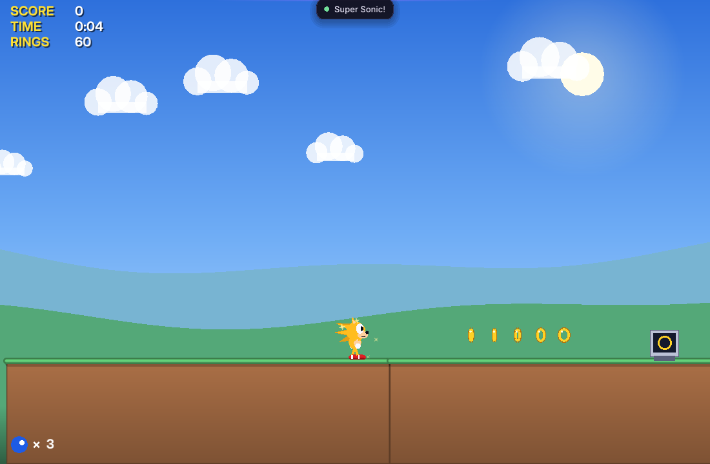

With all seven emeralds and **50 rings**, **jump again in the air** to turn super — any character: golden (sprite sheets too), faster, jumping higher and unhurt by badniks, spikes and the bosses, with Super Sonic's own song. It uses up a ring every second and ends when they run out (or at the goal). Pits and drowning still count.

### Music

Sonic's mode has music, **made by the program** (no sound from the games): a chiptune song for each zone (Meadow, Harbour, and the endless run's Twilight, Snowfield, Lagoon and Storm), the boss's, invincibility's, Super Sonic's and the special stages', and jingles for an act cleared, a 1-up, Game Over, an emerald and the drowning countdown. *Sonic's music* and *Music volume* in the settings' audio section turn it off or down, and it keeps quiet while your own music plays.

### Level editor

The editor's *Badnik* button places every badnik (click it again for the next one: crawler, flyer, crab, fish, gull, puffer), *Boss* again switches between the bomber and the anchor crane, and *Vent* puts an air vent on the sea floor (turn the water on to make an underwater level).

## What's new in 3.0

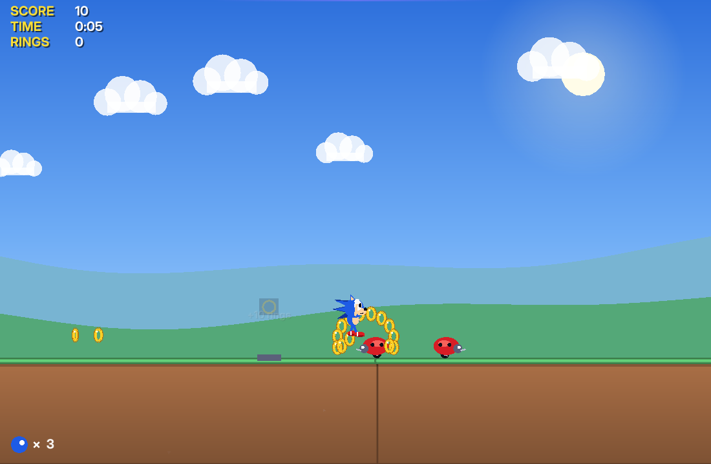

Gravity Engine 3.0 is also a Sonic game: Sonic and his friends play in the sandbox with the physics of the Mega Drive games, through acts with badniks and a boss, an endless run and levels you make yourself. Everything is drawn with shapes; no graphics or sounds from the games are included, but you can give them **your own sprite sheets** (see below).

### Playable Sonic

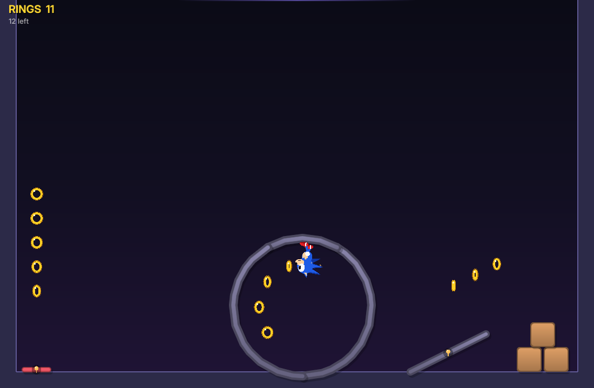

- **`Shift+O`** (or *Sonic* in the settings) — Sonic joins the scene and is played with the keyboard or a controller: `←` `→` run, `↓` crouches or rolls, `Space` jumps (hold for higher), `↓` + `Space` charges a spin dash, `↑` looks up. He moves the way he does in the Mega Drive games, after the [Sonic Physics Guide](https://info.sonicretro.org/Sonic_Physics_Guide): acceleration, braking and friction, slopes that slow him down or speed him up, floor sensors that follow walls and ceilings (he runs round loops), slipping off when too slow, rolling, variable jump height, air drag, and slower physics underwater.
- He pushes objects (curled up, he bowls them over and smashes breakable ones), stands and rides on them, weighs down seesaws, bounces off bouncy surfaces like springs, slides on ice, is launched by conveyors like dash panels, is blown away by bombs and can be picked up and thrown with the Spring tool. The camera follows him in a big world. `Shift+Space` pauses while he is around.
- **Rings** to collect, with a counter; example scene *Sonic loop* (a loop, a spring, a ramp and crates). Sonic and the rings are saved in scene files.
- **Infinite world** (*World size* → `∞` in the settings) — a floor that goes on forever, no walls or ceiling: travel with the middle mouse button, or let the camera follow Sonic. Everything is quietly moved back towards the middle as you go, so it never loses precision.

### Sonic's game mode

**Library → Sonic** (`E`) holds three acts: *Meadow Act 1* (badniks and spikes), *Act 2* (platforms over pits, flyers and crabs) and *Act 3*, where the boss waits.

- **Badniks** — a crawler, a flyer that shoots at Sonic and a crab that lobs shots; jump on them or roll into them (100, 200, 500, 1000… points for each one in a row without landing).
- **Item monitors** to smash: 10 rings, a shield, invincibility, speed shoes and an extra life. **Spikes**, bottomless **pits** and the **boss**, who flies over his arena and takes eight hits (the view locks on the arena until he is beaten).
- Hit while holding rings, Sonic loses them in a circle and has a moment to catch some back; hit without rings, he loses a life. 100 rings make an extra life. **Star posts** are checkpoints.
- **Score, time, rings and lives** on screen; the **goal signpost** spins to end the act, then the tally counts the time and ring bonuses and the next act starts (`Space` / `Enter` / the controller's A). Three lives, then *Game Over*.

### Tails, Knuckles and Amy

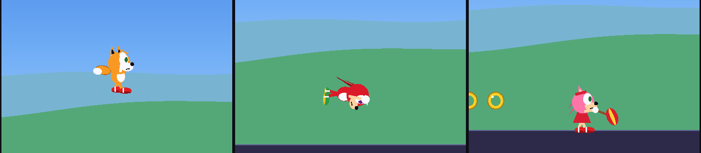

`Shift+N` (or the controller's Select, or *Play as* in the library's Sonic tab) changes who plays:

| | |
|---|---|
| **Sonic** | ↓ + Space spin dash |
| **Tails** | Space again in the air: fly; tap Space to flap; tired after 8 s |
| **Knuckles** | jumps lower; Space again in the air: glide (hold), faster and faster; into a wall: climb ↑ ↓, over the top, or jump off; slides on landing |
| **Amy** | `X` (controller X / □): hammer; Space again in the air: hammer spin; both destroy badniks and break monitors |

While someone plays, `X` is the action button (the Winamp player is on `X` otherwise). The controller's A, B and Y jump.

### Make your own levels

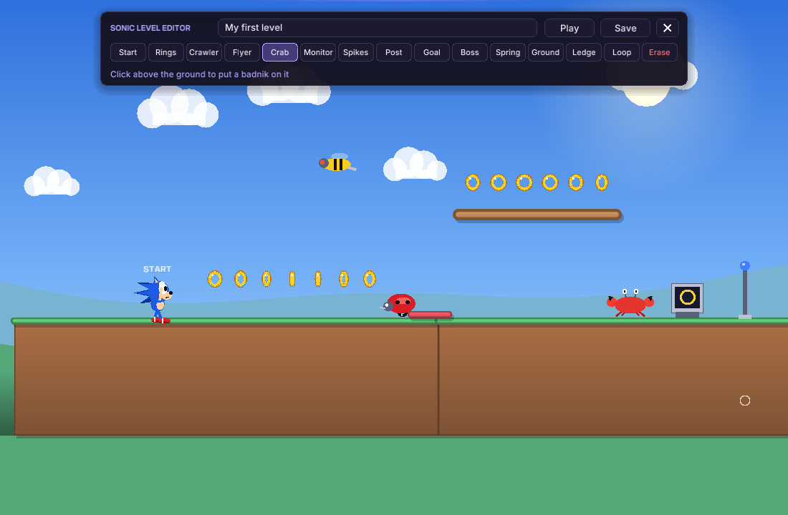

**Library → Sonic → New level** opens the level editor, in the infinite world. Name the level, then pick what to place in the bar and click (or drag) in the world: the start, rings (drag for a row), the three badniks, monitors (click *Monitor* again for the next item), spikes, star posts, the goal, the boss, springs, ground (drag across), ledges and loops; *Erase* takes things away. Things are dropped onto the ground under the pointer. The sandbox tools still work to build the scenery.

*Play* tries the level straight away from its start, *Stop* comes back to the editor. *Save* keeps it in `~/.config/gravity_engine/levels/`: your levels are listed in Library → Sonic after the acts, to play or to edit again (they are ordinary `.gscene` files, so they can be shared).

### A richer endless run

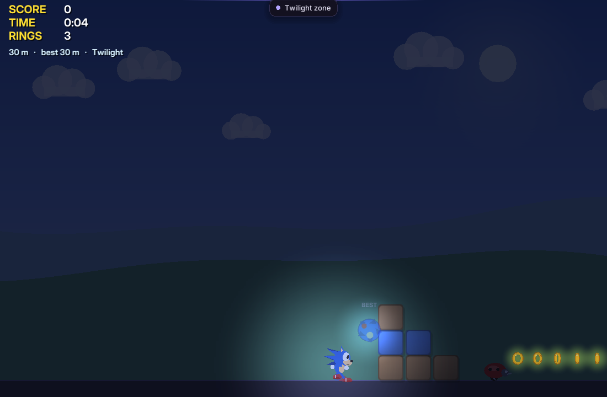

The *Endless run* example (Sonic in the infinite world, with hills, loops, ramps, springs, platforms, crates and rings made ahead of him) now goes through **five zones** — Meadow, Twilight (at night: Sonic carries a light and the rings gleam), Snowfield (snow), Lagoon (water) and Storm peak (rain and lightning) — each with its own colours and sky, and round again. The further you go, the more **badniks, flyers, crabs and spikes**, with the odd monitor.

One life: at the first fall the run is over and starts again. The best run is kept as a **ghost** that races you on the same course next time (`ghost.json`); the distance, your best and the zone are shown under the counters.

### Controllers

A game controller plays Sonic and his friends (Linux joystick devices and XInput on Windows; no extra library): the left stick or d-pad runs, A / B / Y jump, X is the action button, Select changes character and Start pauses. On Windows, hits and explosions make it rumble.

### Performance

`gravity_engine --benchmark` runs five stress scenes (400 shapes, sand and water, a night storm, ragdolls, Sonic's endless run) at a fixed 60 Hz and prints the frame times and where they go — physics, each part of the drawing, waiting for the screen — then quits without touching your settings. Objects and grains outside the view are no longer drawn, which helps in big and infinite worlds.

### Sonic sprite sheets

*Sonic sprites…* in the settings (or putting a PNG in `~/.config/gravity_engine/sonic/`) makes Sonic use a sprite sheet you provide. Nothing is copied into the program: the sheet stays on your computer. Triangly's Sonic 1 sheet from The Spriters Resource (690 × 1558) is recognised as it is. For any other sheet, put a `sheet.json` next to it:

```json
{
  "cell": [66, 66],
  "transparent": [[13, 72, 7], [67, 153, 49]],
  "scale": 1.0,
  "animations": {
    "idle": [[24, 243]],
    "walk": [[24, 334], [94, 334], [164, 334]],
    "run": [[24, 516], [94, 516]],
    "roll": [[24, 607], [94, 607]]
  }
}
```

Each frame is the top-left corner of a `cell`-sized box whose centre is Sonic's centre, facing right; `transparent` lists background colours to cut out and `scale` is sheet pixels per original game pixel. Animations: `idle` (required), `bored`, `walk`, `run`, `roll` (also the spin dash), `skid`, `push`, `crouch`, `look_up`, `spring`; missing ones fall back to `walk` or `idle`. Frames play at the games' speed (held for 8 − speed frames, 4 − speed curled up) and turn with the ground.

Tails, Knuckles and Amy can have theirs as well, recognised by their size and kept as `tails.png`, `knuckles.png` and `amy.png` / `amy.webp`: the Sonic 3 Tails sheet (1174 × 1820) and the Sonic 3 & Knuckles Knuckles sheet (1131 × 1862) from The Spriters Resource, and for Amy either CartoonsAnimate22's sheet (1274 × 2000, its Sonic Mania style) or DeltaConduit's custom sheet in the style of Sonic 1 (583 × 570; original sprites by Sega and Sonic Team). Where each character's centre sits in a picture is worked out from its pixels.

The game mode's objects can come from sheets too, picked the same way (they are recognised by their size and kept beside Sonic's):

- `objects.png`: the Sonic 1 *Common Objects* sheet (712 × 1014): rings, monitors, spikes, star posts, the goal signpost, springs, explosions, the shield, invincibility stars, score numbers and *GAME OVER*;
- `monitors.png`: the Sonic 3 *Monitors* sheet (822 × 813): its monitors when there is no `objects.png`, and the 1-up faces of Tails and Knuckles.

Without them, everything is drawn with shapes.

## What's new in 2.9

| Night: lamps cast shadows | Storm: lightning sets things on fire |
|---|---|
| 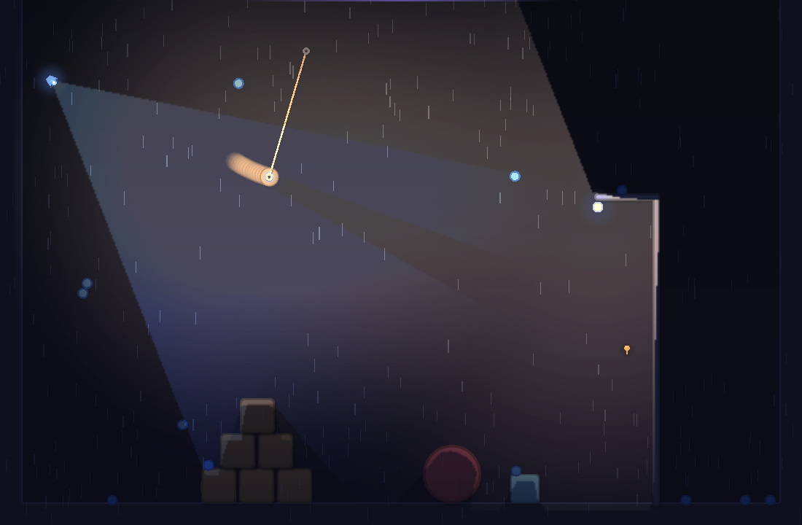 | 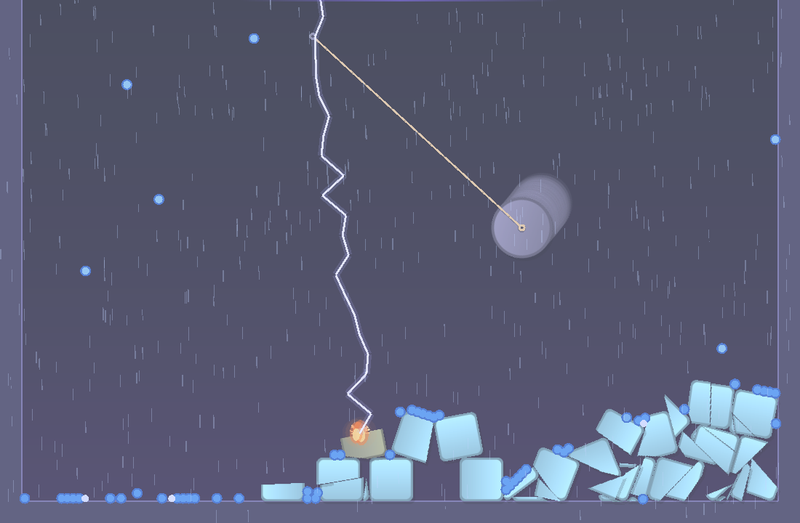 |

| Planets with their own gravity | Grappling hook |
|---|---|
| 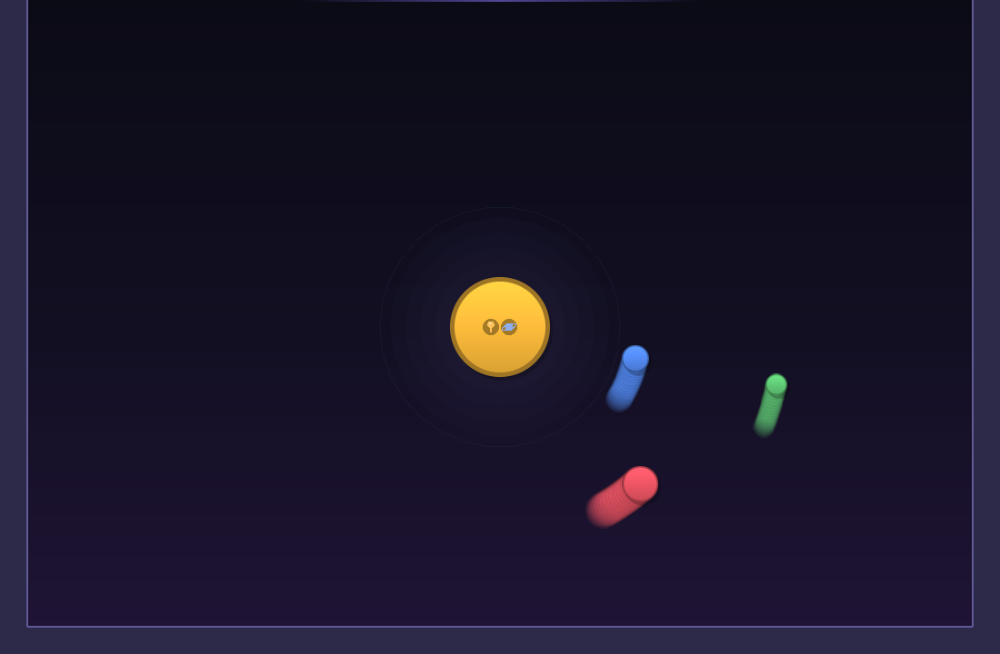 | 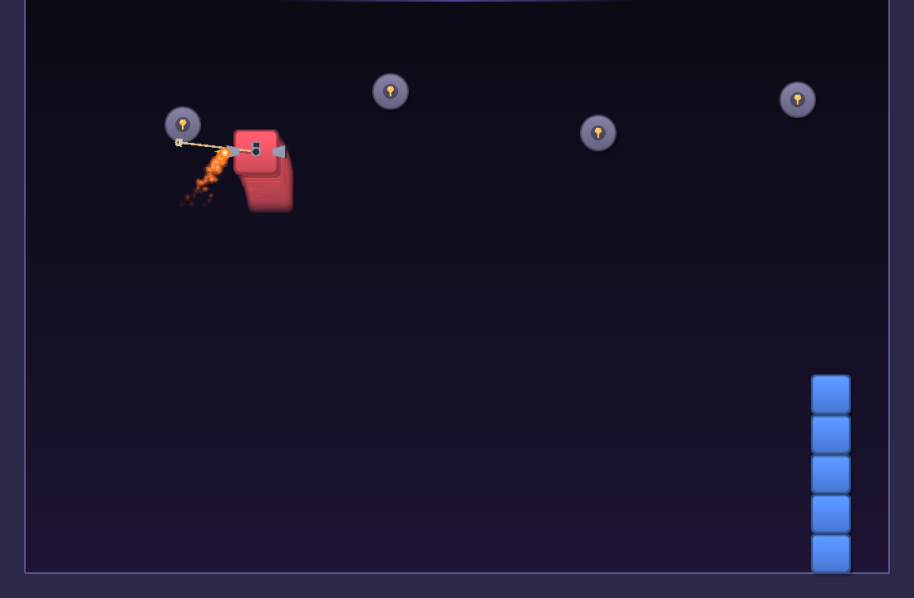 |

- **Planets** — any object can have its own gravity (right-click → *Make it a planet*, or the *Planet gravity* slider and preset in the properties panel): everything nearby falls towards it and can orbit it. Example scene *Solar system*.
- **Weather** (`Shift+H`, or *Weather* in the settings) — **rain** falls as real drops that fill containers and put out fires under the open sky, **snow** settles in drifts (and melts near fire; it is also a new kind of grain for the Pour tool), and a **storm** brings gusts of wind, heavy rain and **lightning** that strikes the highest thing around and sets it on fire, with thunder.
- **Night** (`Shift+T`, darkness in the settings) — the scene goes dark and only light shows it: **lamps** (a new gadget: a bulb all round or a spotlight, in six colours) cast real shadows, and fire, embers, lasers, thrusters, hot objects and lightning glow.
- **Grappling hook** (a new gadget) — put it on an object and hold its arrow key: the hook shoots at the pointer, catches what it hits and reels in; let go to let go. One set to *always* hangs on where it catches, and one fixed in the world is a winch that pulls things in. The knife cuts its rope. Example scene *Grapple swing*.
- Night and weather are saved in scene files; example scene *Night lights*.

## What's new in 2.8

| Lasers and mirrors | Rocket car (← → drive, ↑ thruster, ↓ cannon) |
|---|---|
| 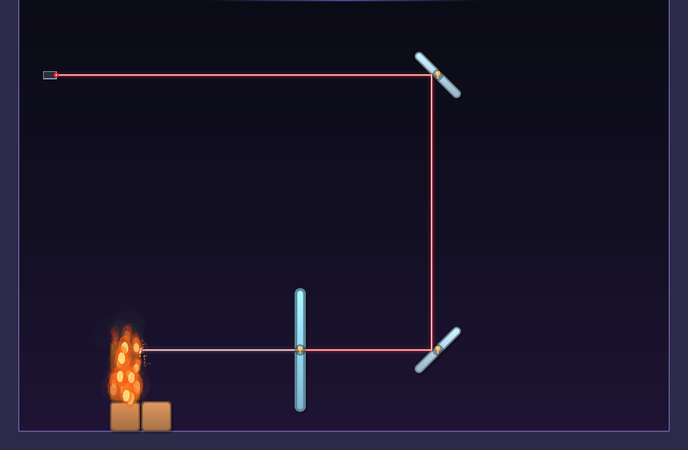 | 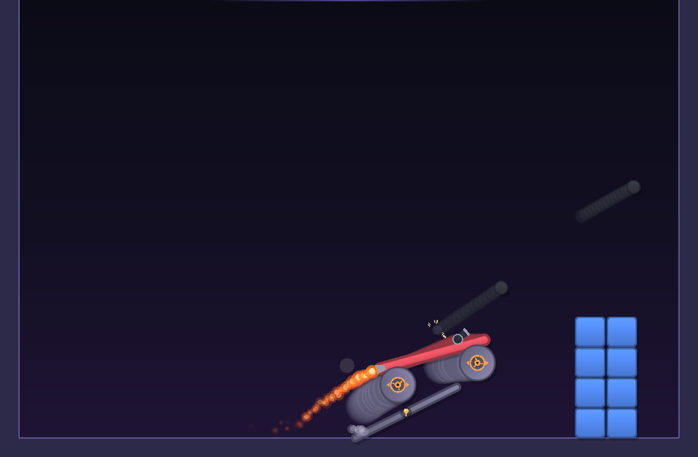 |

- **Gadget tool** (`L`) — attach a **laser**, **thruster** or **cannon** to any object (or fix it in the world), aimed by dragging. Each one works all the time, while an arrow key is held, or on the music's beat.
- **Lasers** — beams bounce off mirrors (a new *Mirror* property and preset), pass through glass and take its colour, and push and set fire to what they hit.
- **Thrusters** push their object with a jet of flame; fixed in the world they blow like a fan. **Cannons** fire balls, shapes, grains or copies of your last image, with recoil.
- **Driven motors** — a motor can be driven with `←` / `→` (Link tool → Motor → *Drive it with ← →*): build a car and drive it. Example scenes *Laser lab* and *Rocket car*.
- **Three laser challenges** — your lines are mirrors: bend the beam into the target.

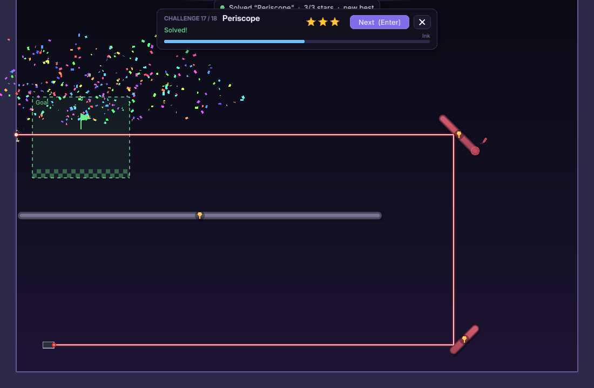

## What's new in 2.7

| Fire (Y) | Jelly and cloth (U, Shift+U) |
|---|---|
| 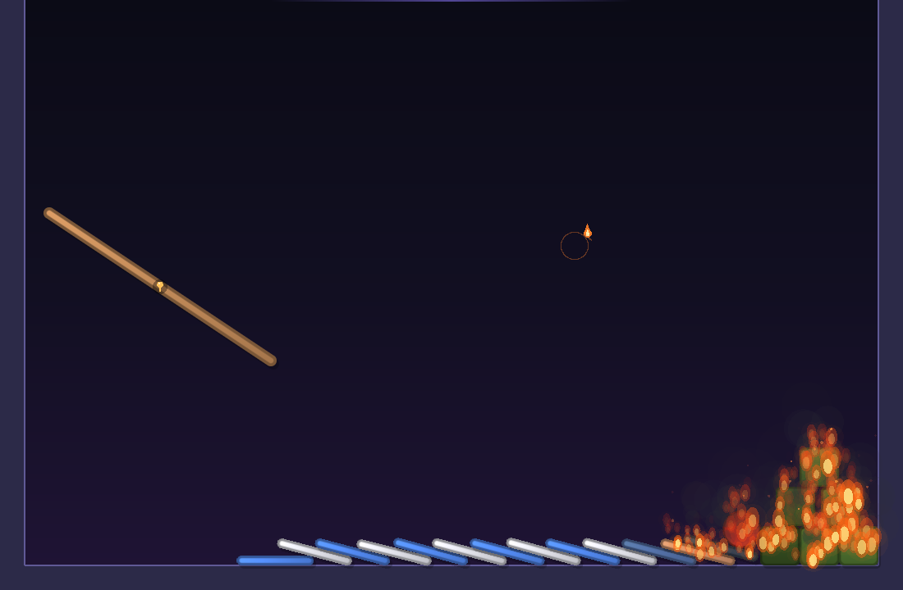 | 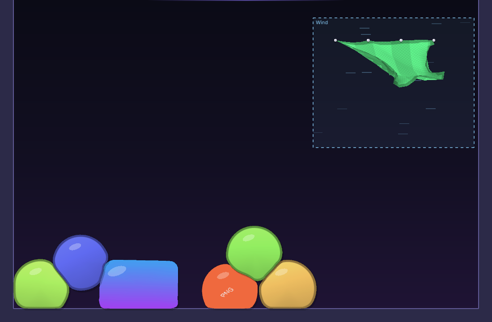 |

- **Fire** (`Y`) — set things alight: fire spreads to whatever touches it (faster upwards), burns ropes through and leaves ash. Ice melts into water, glass cracks, metal glows, and water or poured liquid puts it out. Explosions start fires too.
- **Jelly** (`U`) — squashy, wobbly blobs; press `U` over any image or shape to turn it into jelly.
- **Cloth** (`Shift+U`) — pinned fabric that drapes, flaps in wind zones, tears when pulled too hard, and can be cut with the knife or burnt. Right-click an image → *Hang it as a flag*.
- **Physical player** (`Shift+X`) — the Winamp player becomes a real object: it falls, tumbles, gets blown up and carries things, while all its buttons still work. Grab a title bar to throw it.

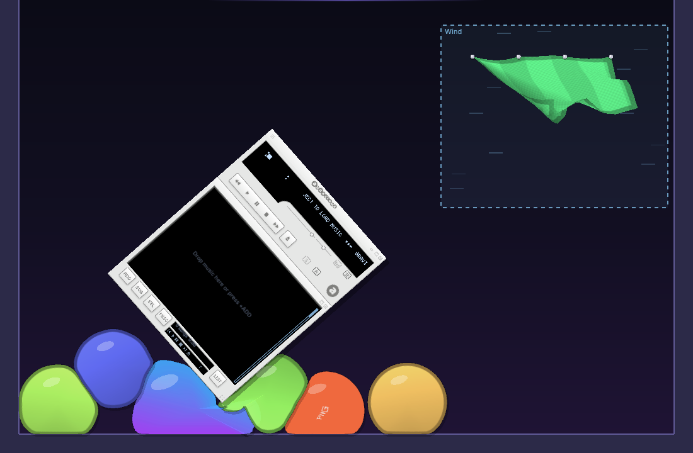

## What's new in 2.6

| Playlist and equalizer | Ragdolls and the knife |
|---|---|
| 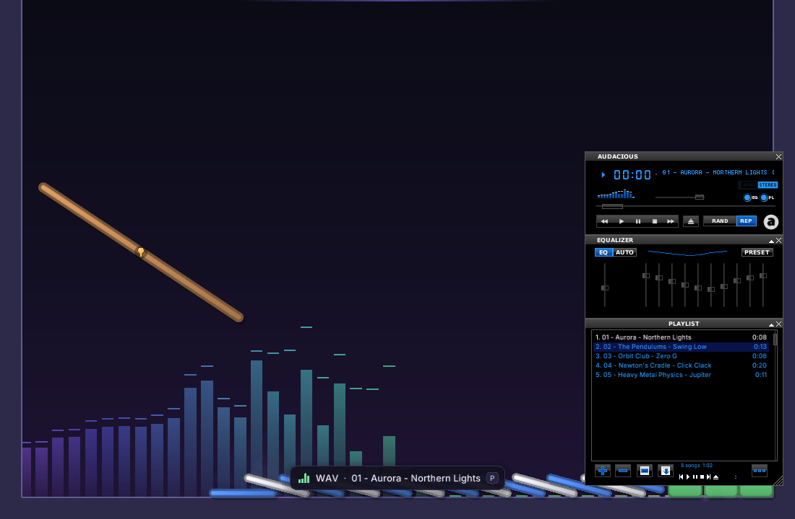 | 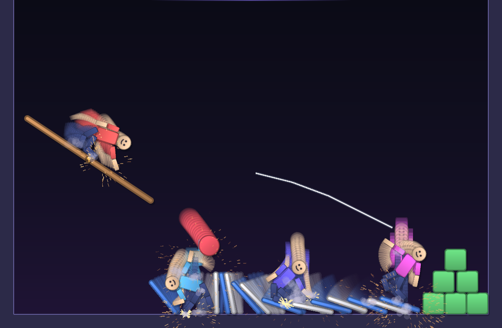 |

- **Playlist and equalizer** — the classic player gets Winamp's playlist window (reorder, remove, sort, shuffle, repeat; kept between sessions, `.m3u` too) and a working 10-band equalizer with presets, both skinned.
- **Rewind** — hold `←` to play the last 8 seconds backwards, then let go to change what happens.
- **Knife** (`C`) — cut ropes, springs and joints, and slice objects in two.
- **Ragdolls** (`O`) — floppy characters; press `O` over an image to make it the head.

## What's new in 2.5

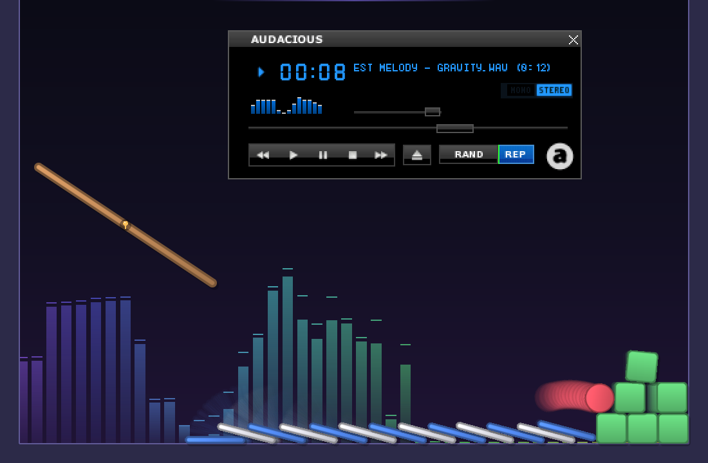

- **Classic player** (`X`) — a Winamp-style window for the music player: transport buttons, time, scrolling title, spectrum, volume and seek bars. Double-click its title bar for double size.
- **Winamp 2 / Audacious skins** — `.wsz` skins and Audacious skin folders (with their `skin.hints` layouts). Installed Audacious skins are found automatically; cycle them in *Settings → Audio → Skin*, or drop a `.wsz` on the window.

## What's new in 2.4

| Challenge editor (Shift+E) | Sand, liquid and beads (K) |
|---|---|
| 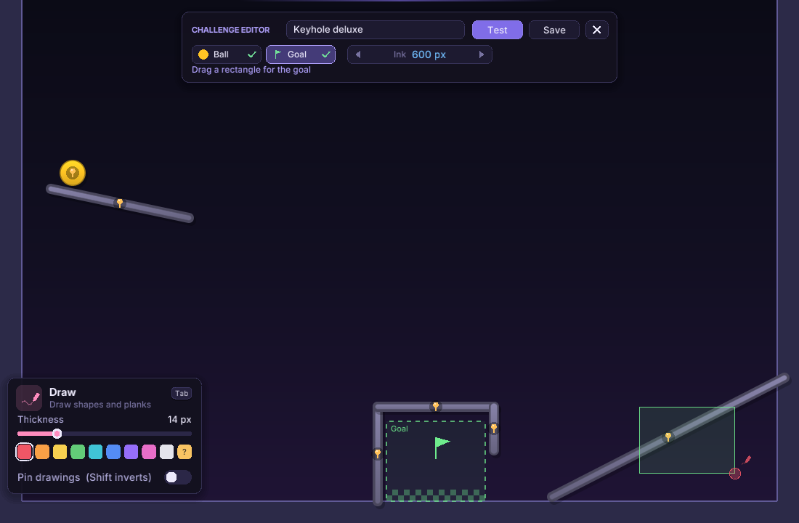 | 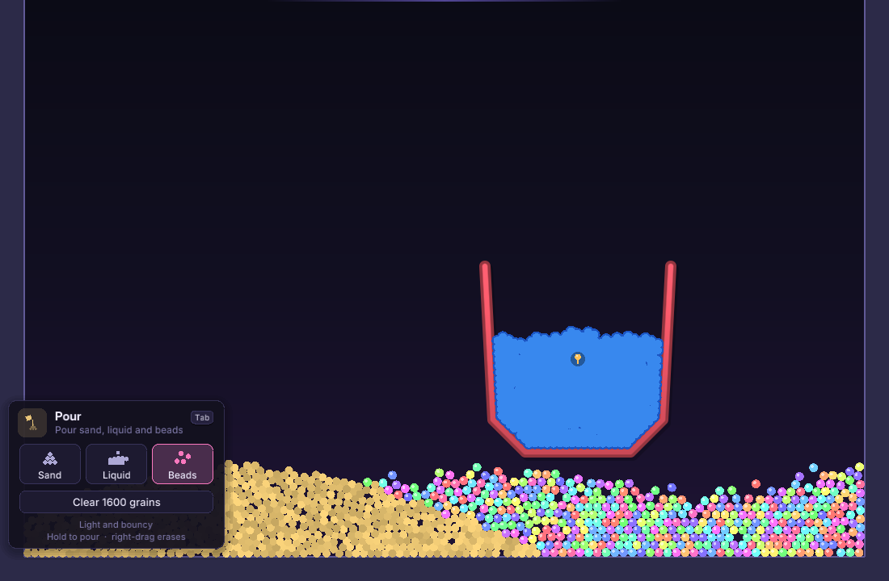 |

- **Challenge editor** — build your own levels: place the ball and the goal, set the ink, test it (you must solve it to save it), and share the `.gchallenge` file. Your levels live in Library → *My challenges*.
- **Ten new challenges** (fifteen in all) and **stars** — ★★★ when you use half the ink or less.
- **Sound effects** — synthesised hits (by size and material), breaking glass, explosions, pops and a win fanfare.
- **Slow motion** — time slows for a moment on shatters, explosions and very hard hits.
- **Camera** — `Ctrl`+wheel or `+` / `-` to zoom, middle-drag to pan, `Home` to fit; worlds up to 3× the window (*World size*).
- **Select tool** (`S`) — box-select, move, copy / paste, duplicate, pin, delete, and **glue** objects into rigid groups.
- **Pour tool** (`K`) — sand that piles up, a liquid that flows, bouncy beads.

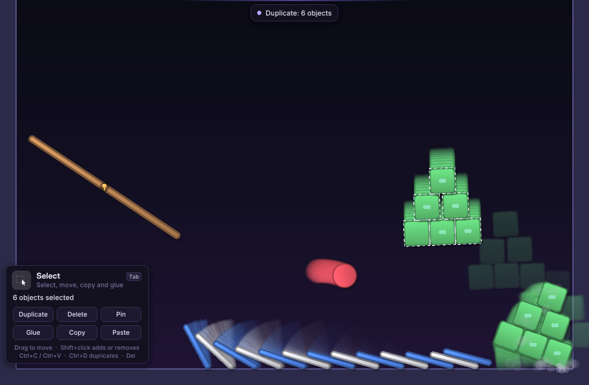

## What's new in 2.3

| Challenges (E) | Breakable objects |
|---|---|
| 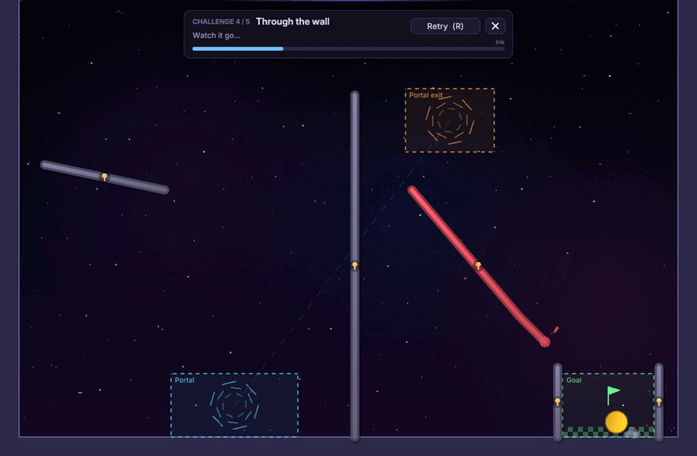 | 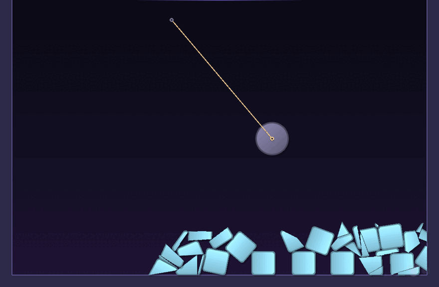 |

- **Challenges** — five puzzles: draw lines (with limited ink) so the golden ball reaches the goal. `Space` to release it, `R` to retry.
- **Example scenes** — Newton's cradle, domino run, a car, a wrecking ball, a pool party, magnets, a conveyor factory and a portal loop, all in the library (`E`).
- **Breakable objects** — objects marked *Breakable* (or *Glass*) shatter into real pieces on hard impacts.
- **Particle effects** — sparks, dust, splashes, debris and confetti.
- **Motors** — spinning hinges for wheels, mills and cars (Link tool → Motor).
- **Zone tool** (`Z`) — wind, float and portal areas.
- **Magnets and conveyor surfaces** in the Properties panel.

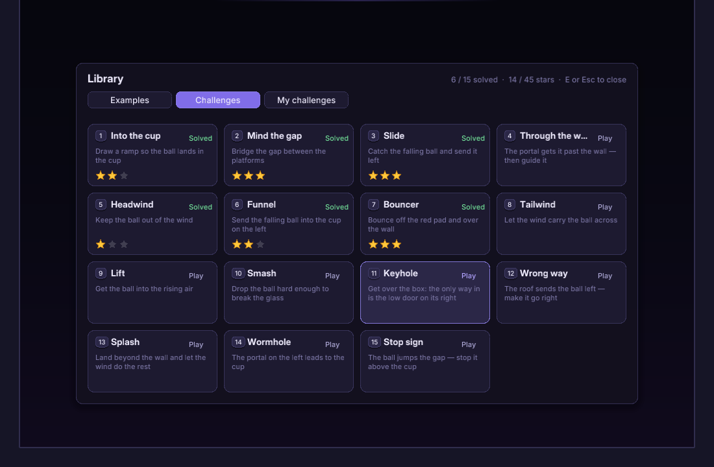

## What's new in 2.2

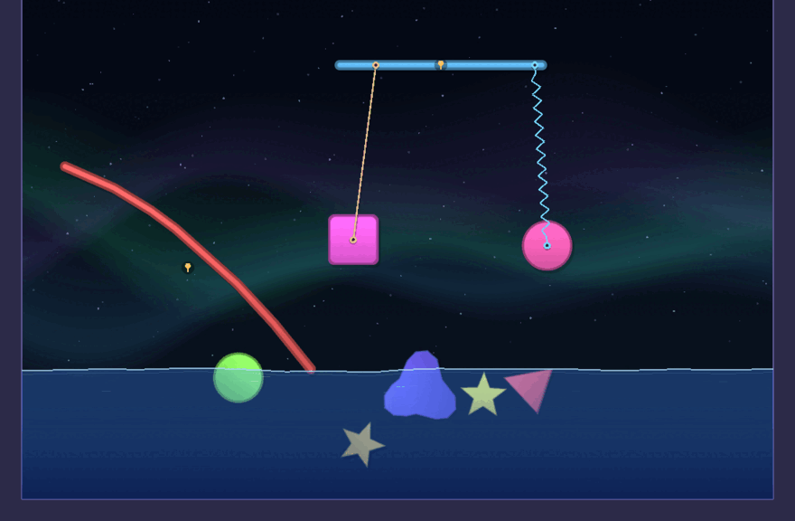

- **Draw tool** (`0`) — draw with the mouse: a loop becomes a filled shape, a line becomes a plank. Pin drawings to build ramps and courses.
- **Link tool** (`J`) — ropes, springs and hinges between objects, or to the background.
- **Undo / redo** (`Ctrl+Z` / `Ctrl+Y`) for every edit.
- **Object properties** (right-click → *Properties…*, or `I`) — bounce, friction, mass and gravity, with presets (Rubber, Ice, Heavy, Balloon).
- **Water** (`H`) — buoyancy and drag; light objects float, heavy ones sink, and the waves follow the music.
- **GIF recording** (`F11`) — record the scene without the interface.
- **Windows build** on the releases page.

## What's new in 2.0 (remaster)

- **New UI** — floating HUD, a settings drawer that slides in when paused, a tool picker with animated icons, toasts, a “now playing” pill, redesigned menus, help and title screen, bundled [Inter](https://rsms.me/inter/) font.
- **Scenes** — save and reopen whole scenes (`Ctrl+S` / `Ctrl+O`, `.gscene`); images are embedded so scenes can be shared.
- **Persistent settings** — gravity, tool, trails, volume, background… are restored on the next launch.
- **Drag & drop** files onto the window (images, audio, playlists, scenes).
- **Screenshots** (`F12`), **slow motion** (`[` / `]`) and **frame-by-frame stepping** (`.` while paused).
- **Pin objects** in place (right-click → *Pin*); pinned objects can still be dragged around with *Spring*.
- **Swing tool** (`9`) — hold objects by the point you click; they dangle and spin when thrown.
- **Better physics** — frame-rate independent simulation (it used to run faster on high-refresh screens), mass-aware tools, exact colliders for spawned shapes (balls, capsules, rounded boxes, concave stars), a ceiling so *Reverse* gravity no longer loses your objects.
- **New content** — Hexagon and Capsule shapes, random-colour spawning, hold-to-spawn, *Aurora* background, smooth gradient backgrounds.
- **Fixes** — duplicate/resize now work for fetched buttons and spawned shapes, correct animated-GIF disposal, window tracking no longer stalls frames, web fetches run in parallel.

## Features

- **Drop any image** — PNG, JPG, GIF (animated), WebP, BMP, SVG, TIFF, ICO, TGA, QOI…; transparency is used to compute convex-hull colliders
- **Shape spawner** (`N`) — Circle, Box, Triangle, Pentagon, Hexagon, Star, Capsule; pick a colour (or random) and size, click or hold to spawn
- **88×31 button fetcher** (`F`) — 20 random classic web buttons scraped from 8 galleries (animated GIFs supported)
- **Game logo fetcher** (`L`) — 20 random logos from [SteamGridDB](https://www.steamgriddb.com/) (needs an API key, see below)
- **17 tools** — `Tab`, `1`–`9`, `0`, `J`, `Z`, `S`, `K`, `C`, `Y` or `L`:

  | # | Tool | Description |
  |---|------|-------------|
  | 1 | Spring | Grab, carry and throw (no spin) |
  | 2 | Slingshot | Pull back, release to launch |
  | 3 | Pull | Attract everything nearby |
  | 4 | Push | Repel everything nearby |
  | 5 | Vortex | Spin objects around the cursor |
  | 6 | Freeze | Slow objects to a crawl |
  | 7 | Orbit | Make objects circle the cursor |
  | 8 | Bomb | Click to detonate |
  | 9 | Swing | Hold by the clicked point: objects dangle and spin when thrown |
  | 0 | Draw | Draw shapes and planks (`Shift` pins / unpins them) |
  | J | Link | Ropes, springs, hinges, motors and glue between objects, or to the background |
  | Z | Zone | Wind, float and portal areas |
  | S | Select | Select objects (click, `Shift`+click, box), move them, copy / paste, duplicate, pin, delete, glue |
  | K | Pour | Pour sand, liquid or beads; right-drag erases |
  | C | Knife | Cut ropes, springs, joints and cloth; slice objects in two |
  | Y | Fire | Set things on fire, melt ice |
  | L | Gadgets | Lasers, thrusters (or fans), cannons, lamps and grappling hooks, always on, on an arrow key or on the beat |

  The tool card (bottom left) holds each tool's settings: radius / strength for area tools (mouse wheel: radius, `Shift`+wheel: strength), thickness, colour and pinning for Draw, the kind of link (and motor speed) for Link, the kind of zone for Zone, the selection commands for Select and the kind of grain for Pour.
- **8 border modes** — `B` to cycle (`Shift+B` backwards):

  | Mode | Description |
  |------|-------------|
  | Walls | Solid walls all around |
  | Loop | Objects wrap left ↔ right |
  | Kill | Objects leaving the sides are deleted |
  | Warp | Objects wrap on all four sides |
  | Bounce | Springy trampolines on the sides |
  | Repulse | Soft force field on every edge |
  | Portal | No floor — every edge is a portal, animated rainbow borders |
  | Open | No walls and no floor: what falls off is gone (pits in Sonic's levels) |
- **7 backgrounds** — `G` to cycle: Dark, Space, Grid, Sunset, Ocean, Aurora, Custom (`Shift+G` picks an image)
- **Water** (`H`) — a pool with buoyancy and drag; level and density in the settings drawer, waves react to splashes and to the music
- **Object properties** — bounce, friction, mass, gravity, planet gravity, breakable, flammable, mirror, magnet and conveyor per object (right-click → *Properties…*, or `I`)
- **Library** (`E`) — example scenes, eighteen challenges (three with a laser) with star ratings, and your own challenges
- **Challenge editor** (`Shift+E`) — make levels and share them as `.gchallenge` files
- **Camera** — zoom (`Ctrl`+wheel, `+` / `-`, `Home` to fit) and pan (middle mouse button); *World size* makes the arena up to 3× the window, or infinite
- **Sound effects and slow motion** — procedural sounds for hits, glass, explosions and wins; a moment of slow motion on big impacts (both can be turned off)
- **Undo / redo** — `Ctrl+Z` / `Ctrl+Y` for every edit
- **Gravity** — presets ZERO / MOON / MARS / EARTH / JUPITER / HEAVY / REVERSE in the HUD, or any value with the slider
- **Window shake** (`W`) — moving the window pushes every body; KDE Wayland via KWin DBus, X11 otherwise
- **Trails** (`T`) — motion-blur ghost trail with length and fade settings
- **Audio visualizer** — `V` cycles a spectrum layer behind the objects (Bars / Wave / Radial); `Shift+V` drops a visualizer *screen* that is a real physics object (throw it, pin it, resize it). Sensitivity and an optional "objects jump on the beat" mode live in the settings drawer
- **Audio player** (`M`) — tracker modules (.mod/.xm/.it/.s3m/…), common formats (.mp3/.flac/.wav/.ogg/…), `.pls` playlists including HTTP radio streams
- **Classic player** (`X`) — Winamp-style window with play / pause / stop / next / previous / seek / volume, a playlist window (shuffle, repeat, reorder, `.m3u` / `.pls`) and a 10-band equalizer, skinned with Winamp 2 `.wsz` or Audacious skins (found automatically in Audacious's skin folders, `~/.config/gravity_engine/skins/`, or dropped on the window). `Shift+X` turns it into a physical object you can throw around
- **Rewind** (hold `←`) — play the last 8 seconds backwards
- **Ragdolls** (`O`) — floppy characters with limited joints (over an image: it becomes the head)
- **Fire and heat** (`Y`) — burning, spreading fire, ash, melting ice, cracking glass; water puts it out
- **Jelly and cloth** (`U` / `Shift+U`) — soft bodies from any image or shape, and fabric that drapes, flaps in the wind and tears
- **Gadgets** (`L`) — lasers that reflect off mirrors and cross glass, thrusters, fans, cannons, lamps and grappling hooks; motors driven with the arrow keys
- **Planets** — objects with their own gravity that others orbit
- **Playable Sonic** (`Shift+O`) — arrows and `Space`, with the physics of the Mega Drive games: loops, rolling, spin dash, rings; **Tails, Knuckles and Amy** (`Shift+N`) fly, glide and climb, and swing a hammer
- **Sonic's game mode** (Library → Sonic) — six acts in two zones (Meadow and Harbour) with badniks, monitors, spikes, pits, water to drown in, star posts, two bosses and the goal signpost; score, time, lives and the end-of-act tally
- **Special stages** — 50 rings at a goal open a giant ring to a Blue Spheres stage; win the seven **chaos emeralds** and turn **super** (any character)
- **Music** — chiptune songs and jingles for Sonic's mode, made by the program
- **Level editor** (Library → Sonic → *New level*) — make Sonic levels, try them and keep them in *My levels*
- **Endless run** — five zones, more and more badniks, and the best run's ghost to race
- **Game controllers** — play with a pad (Linux and Windows; it rumbles on Windows)
- **Weather and night** (`Shift+H` / `Shift+T`) — rain, snow and storms with lightning; a night lit by lamps with shadows, fire and lasers
- **Screenshots** (`F12`) and **GIF recording** (`F11`, up to 30 s) of the scene, without the interface
- **Debug overlay** (`D`) — FPS, collider outlines, velocities and details of the object under the cursor
- **In the browser** — the [web version](https://elimanee.github.io/gravity-engine/) runs the same program (without the features that need files or the network)

## Controls

Press **F1** in the app for the full list.

| Key / Input | Action |
|-------------|--------|
| Left-drag | Use the current tool |
| Right-click | Object menu (Resize, Duplicate, Resize all, Properties, Pin, Make it a planet, Make it jelly, Hang it as a flag, Detach links, Delete) |
| `Tab` / `1`–`9`, `0`, `J`, `Z`, `S`, `K`, `C`, `Y`, `L` | Tool picker / select a tool |
| `←` (hold) | Rewind time (`Shift+←` when `←` drives something) |
| `←` `↑` `→` `↓` | Drive motors, work the gadgets set to an arrow (a grappling hook shoots at the pointer) |
| `O` | Drop a ragdoll (over an image: it becomes the head) |
| `Shift+O` | Sonic joins (or leaves): `←` `→` run, `↓` roll, `Space` jump, `↓` + `Space` spin dash, `Shift+Space` pause |
| `Shift+N` / `X` | Next character (Sonic, Tails, Knuckles, Amy) / action button while someone plays (Amy's hammer) |
| `Space` twice | In the air with all seven emeralds and 50 rings: turn super |
| Special stage | `←` `→` turn at the next crossing · `Space` jump · `↑` run forward again after a bumper · `Esc` leave |
| Controller | Stick or d-pad: run · A / B / Y: jump · X: action · Select: next character · Start: pause |
| `U` / `Shift+U` | Jelly / cloth (over an object: it turns to jelly / is hung as a flag) |
| `E` / `Shift+E` | Library (examples, challenges, Sonic's acts and levels) / challenge editor |
| `Ctrl`+Wheel, `+` / `-`, `Home` | Zoom at the pointer, zoom in / out, fit the world |
| Middle-drag | Pan the view |
| `Ctrl+C` / `Ctrl+V` / `Ctrl+D` / `Ctrl+A` / `Ctrl+G` | Copy / paste / duplicate / select all / glue (Select tool) |
| `Space` / `R` / `Enter` (in a challenge) | Release the ball / retry / next challenge |
| Wheel / `Shift`+Wheel | Tool radius / strength (Draw: thickness; spawn size when the spawner is open) |
| `I` | Properties of the object under the cursor |
| `Ctrl+Z` / `Ctrl+Y` | Undo / redo |
| `A` | Add images |
| `N` | Shape spawner |
| `F` / `Shift+F` | Fetch 88×31 buttons / game logos |
| `Del` | Delete the object under the cursor |
| `R` | Clear all objects |
| `Space` | Pause and open the settings drawer |
| `.` | Step one frame (while paused) |
| `[` / `]` | Slower / faster time |
| `B` / `G` | Next border mode / background |
| `Shift+G` | Background from an image |
| `W` / `T` / `H` | Toggle window shake / trails / water |
| `Shift+H` / `Shift+T` | Next weather (clear, rain, snow, storm) / night |
| `M` / `P` | Load music / play-pause |
| `X` / `Shift+X` | Classic player (Winamp / Audacious skins) / make it a physical object |
| `V` / `Shift+V` | Visualizer behind objects / spawn a visualizer screen |
| `Ctrl+S` / `Ctrl+O` | Save a scene / open a scene or a challenge |
| `F12` / `F11` | Screenshot / start or stop a GIF recording (scene only, without UI) |
| `D` | Debug overlay |
| `F1` | Help |
| `Esc` | Close the top-most panel, or quit |
| `Q` | Quit |

## Download

Linux and Windows builds are attached to each [release](https://github.com/elimanee/gravity-engine/releases). On Windows, unzip `gravity_engine-windows-x86_64.zip` and run `gravity_engine.exe` (keep the DLLs next to it).

Or play the [web version](https://elimanee.github.io/gravity-engine/) in your browser, with nothing to install.

## Build & Run

Requires Rust (stable) plus a few system libraries. On Debian / Ubuntu:

```bash
sudo apt install pkg-config libopenmpt-dev libasound2-dev libx11-dev libxi-dev \
                 libgl1-mesa-dev libwayland-dev libxkbcommon-dev libgtk-3-dev libdbus-1-dev
cargo run --release
```

Command line: `gravity_engine [--no-title] [--benchmark] [FILES…]` — files can be images, audio, playlists, `.gscene` scenes, `.gchallenge` challenges or `.wsz` skins. `--act=N` and `--special-stage=N` go straight into Sonic act N (1–6) or special stage N (1–7).

`gravity_engine --benchmark` runs five stress scenes for a few seconds each at a fixed 60 Hz and prints the frame times (average, 95th percentile, worst), the bodies still moving, the time spent waiting for the screen and where each frame's time goes, then quits without saving anything.

`gravity_engine --verify-challenges` plays every built-in challenge with its reference solution (and once without drawing) and reports whether each one is solvable within its ink — handy when designing levels.

On Windows, install libopenmpt with [vcpkg](https://vcpkg.io) (`vcpkg install libopenmpt:x64-windows`), copy its `libopenmpt.lib` to a folder as `openmpt.lib`, set `OPENMPT_LIB_DIR` to that folder and run `cargo build --release`; the DLLs from vcpkg's `installed\x64-windows\bin` must sit next to the executable (or be on `PATH`). `.github/scripts/openmpt-windows.ps1` does all of this in CI.

The web version needs the `wasm32-unknown-unknown` target (`rustup target add wasm32-unknown-unknown`); `web/build.sh` builds it into `web/dist/` with its page and loader, ready to serve from any web server (`python3 -m http.server -d web/dist`). The *Web version* workflow publishes it on GitHub Pages from `master` (the repository's Pages source must be *GitHub Actions*).

For the fastest (but non-portable) binary, build for your own CPU:

```bash
RUSTFLAGS="-C target-cpu=native" cargo build --release
```

## Files & configuration

Everything lives in `~/.config/gravity_engine/` (or `$XDG_CONFIG_HOME/gravity_engine/`, or `%APPDATA%\gravity_engine\` on Windows):

| File | Purpose |
|------|---------|
| `settings.json` | Your preferences, saved on exit (also the acts' best scores and the chaos emeralds found). Set `"show_title": false` to skip the title screen. |
| `scenes/` | Default folder for saved scenes |
| `challenges/` | Challenges made in the editor (`.gchallenge`), listed in Library → *My challenges* |
| `levels/` | Sonic levels made in the level editor (`.gscene`), listed in Library → *Sonic* |
| `sonic/` | Your sprite sheets for Sonic, Tails, Knuckles, Amy and the game's objects (see *Sonic sprite sheets*) |
| `ghost.json` | The endless run's best run, raced as a ghost |
| `skins/` | Extra Winamp / Audacious skins (`.wsz` files or folders) for the classic player |
| `sgdb_key` | SteamGridDB API key for the logo fetcher (or set `SGDB_API_KEY`) |

Screenshots and GIFs go to `~/Pictures/gravity_engine/` (or `~/.config/gravity_engine/screenshots/` if you have no Pictures folder).

In the web version, the same files are kept in the browser's local storage for the page.

## Project layout

```
src/
├── main.rs            entry point, window config, CLI
├── storage.rs         the player's files: on disk, or in the browser's storage (web version)
├── dialog.rs          file dialogs (none in the web version)
├── app/               app state and frame loop (input → UI → actions → simulation → render),
│                      building tools, selection, impacts and shattering, fire, jelly and
│                      cloth, gadgets, grappling hooks, weather, night lights, the physical
│                      player, sounds and slow motion, challenge mode, challenge editor and verifier,
│                      Sonic's game, the level editor, the endless run and the benchmark
├── camera.rs          zoom / pan and the world ↔ screen mapping
├── config.rs          constants and paths          settings.rs   persisted preferences
├── skin.rs            Winamp 2 / Audacious skins (.wsz, folders, skin.hints)
├── assets.rs          image / GIF / SVG decoding   shapes.rs     procedural shapes
├── scene.rs           .gscene save / load          background.rs animated backgrounds
├── drawing.rs         Draw-tool strokes → shapes   history.rs    undo / redo
├── recorder.rs        GIF recording                net.rs        web fetchers
├── effects.rs         particles                    library/      examples, challenges, acts, levels
├── weather.rs         rain, snow and lightning     lighting.rs   the night's light map and shadows
├── sonic/             Sonic, Tails, Knuckles and Amy: movement after the Sonic Physics Guide, their
│                      moves, their drawing with shapes and from sprite sheets
├── game/              Sonic's game mode: badniks, monitors, spikes, star posts, the bosses, air and
│                      bubbles, lives and score, and its objects drawn with shapes or from sprite sheets
├── special/           special stages: the globe of spheres, its seven layouts and its drawing
├── gamepad.rs         game controllers (Linux joystick devices, XInput)
├── profile.rs         the benchmark's frame profiler
├── window_tracker.rs  window shake
├── audio/             tracker modules, streams, playlists, the visualizer's analyzer, sound effects,
│                      Sonic's music, and the sound output (rodio, or WebAudio in the browser)
├── physics/           world, objects, tools, links, zones, water, grains, soft bodies, gadgets, magnets,
│                      planets, fracture, border modes
└── ui/                theme, widgets, HUD, drawer, tool card, menus, properties panel, overlays, title screen
web/                   the web version's page, its WebAudio / storage plugin and build script
```

`cargo test` runs the unit tests (decoding, shapes, drawings, links, glue, motors, conveyors, magnets, zones, water, grains, snow, jelly, cloth, laser beams, gadgets, planets, rope reeling, weather, night light, Sonic's running, jumping, spin dash, underwater speed and loops, Tails' flight, Knuckles' glide and climb, Amy's hammer, badniks, monitors, rings, lives and the bosses, air and bubbles, Super Sonic, the special stages, the acts, the music, sprite sheets, the endless run's zones, controllers, the profiler, fracture, particles, sound synthesis, camera, scenes, challenge files, the built-in library, undo, GIF encoding, settings, playlist parsing, scraping…).

`gravity_engine --verify-challenges` (needs a display) checks that every built-in challenge can be solved.

## Usage of AI
this project is mainly developed by ai (totally not with claude )BUT the project will be rewritten at some point in future (if i don't get too lazy)
(might not be GDPR friendly)

## Stack

- [`macroquad`](https://github.com/not-fl3/macroquad) — windowing, rendering, input
- [`rapier2d`](https://rapier.rs/) — 2D rigid body physics
- [`rodio`](https://github.com/RustAudio/rodio) + [`symphonia`](https://github.com/pdeljanov/Symphonia) — audio decoding
- [`openmpt`](https://lib.openmpt.org/) + [`cpal`](https://github.com/RustAudio/cpal) — tracker module playback
- [`resvg`](https://github.com/RazrFalcon/resvg) — SVG rasterization
- [`rfd`](https://github.com/PolyMeilex/rfd) — native file dialogs
- [`image`](https://github.com/image-rs/image) / [`gif`](https://github.com/image-rs/image-gif) — image loading and processing
- [`ureq`](https://github.com/algesten/ureq) — HTTP for the web fetchers and audio streams
- [`serde`](https://serde.rs/) — settings and scene files
- [`x11`](https://github.com/erlepereira/x11-rs) / [`zbus`](https://github.com/dbus2/zbus) / [`windows-sys`](https://github.com/microsoft/windows-rs) — window position tracking (X11 / KDE Wayland / Windows)

The bundled Inter font is © The Inter Project Authors, licensed under the SIL Open Font License 1.1 (`assets/fonts/OFL.txt`).
